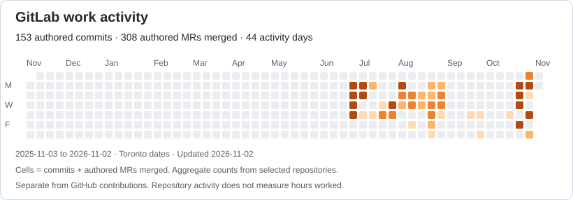

- 👋 Hi, I’m Zachary McKay
- 👀 I’m interested in mechanical and biomedical engineering, entrepreneurship, and leadership roles.
- 🌱 I’m currently learning advanced 3D modelling, Python applicitations, and AI integration in healthcare.
- 💞️ I’m looking to collaborate on engineering projects, especially those focusing on innovation from a medical perspective
- 📫 How to reach me: https://www.linkedin.com/in/zacharyrobertmckay/
- ⚡ Fun fact: I’ve played rep hockey for 10 years and love skiing and weightlifting

<!---
ZachMckay47/ZachMckay47 is a ✨ special ✨ repository because its `README.md` (this file) appears on your GitHub profile.
You can click the Preview link to take a look at your changes.
--->

## GitLab work activity

Aggregate activity from selected work repositories; refreshed weekly.
